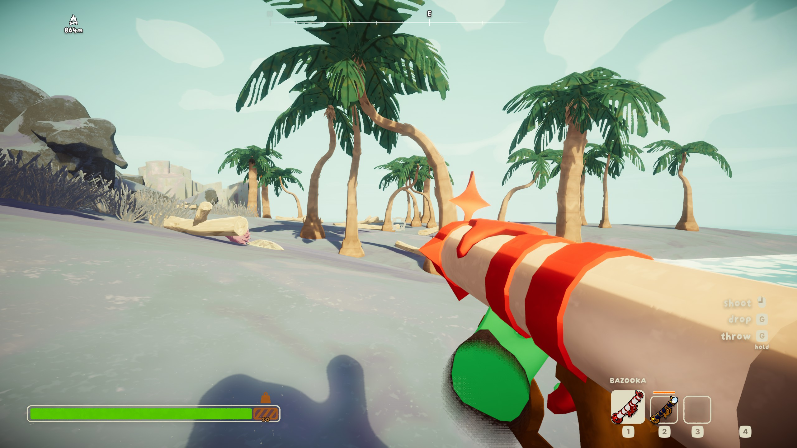
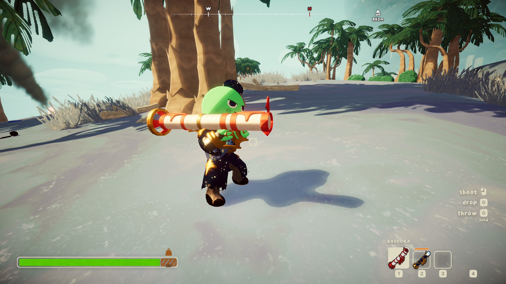
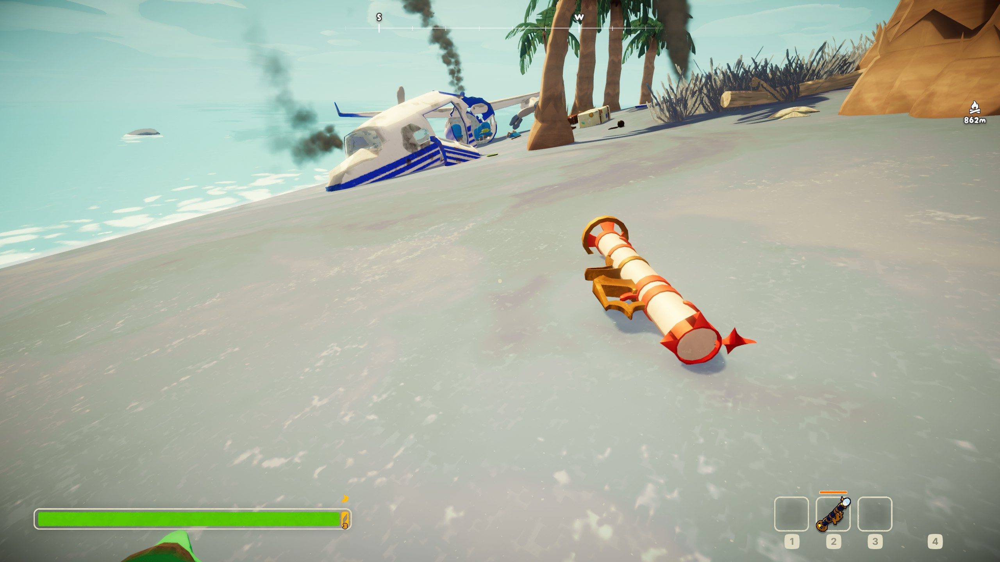

# Bazooka







A red-and-white bazooka for PEAK, built from the AntiZooka. Click to fire a rocket that explodes on impact: it throws zombies, scouts and creatures around, kills the critters that make the climb miserable, and cooks whatever food is lying in the blast. That is **Standard** mode, the default. Switch to **RocketJump** mode and it stops hurting scouts and becomes a way to fly up the mountain.

The bazooka is a new item. The vanilla AntiZooka stays as it is.

## Install

1. Install **Bazooka** from [Thunderstore](https://thunderstore.io/c/peak/p/FakeGameDevelopers/Bazooka/) with r2modman or Gale. It pulls in what it needs: [BepInExPack for PEAK](https://thunderstore.io/c/peak/p/BepInEx/BepInExPack_PEAK/), [PEAKLib Core](https://thunderstore.io/c/peak/p/PEAKModding/PEAKLib_Core/) and [PEAKLib Items](https://thunderstore.io/c/peak/p/PEAKModding/PEAKLib_Items/).
2. Launch PEAK from the mod manager. Starting the game from Steam skips BepInEx.

To install by hand, put `PeakBazooka.dll` in `BepInEx/plugins/FakeGameDevelopers-Bazooka/` next to those dependencies.

In multiplayer, everyone needs the mod, on the same version.

## Two modes

Pick one with `Mode` under `[Bazooka]`: `Standard` (the default) or `RocketJump`. You can switch mid-run; it applies on the next shot. In multiplayer, the host's mode applies to everyone.

| | **Standard** (default) | **RocketJump** |
|---|---|---|
| What it is for | A weapon | Getting around: rocket jumping in the style of TF2's soldier |
| Other scouts | Injured (up to 0.4 Injury) and flung | Never hurt or pushed |
| Your own blast | Ragdolls and flings you, and hurts you (a quarter of your health at point-blank) | Launches you on your feet: steer and brake with WASD, no damage, no fall damage when you land |
| Recoil when firing | Pushes you back | None |
| Zombies, creatures and everything else | Hit | Hit the same way |
| Settings that apply | `SelfDamage`, `SelfKnockback`, `SelfKnockbackUp`, `Recoil` | The `[RocketJump]` section |

**Standard:** stand back from your own blast. A floor shot at your feet throws you as a ragdoll, which gets you somewhere fast, at a cost.

**RocketJump:** rockets never hurt any scout, you included. Shoot the floor to go up, the floor behind you to go forward, a wall to go sideways. A rocket under you while you fall cancels the fall and launches you again, so you can chain jumps up a cliff.

## What rockets do

A rocket flies straight with a slight drop and explodes on the first thing it touches. It still explodes if you put the bazooka away while it is in the air.

- **The blast:** a 3.5m fireball. Its push reaches 6m and is strongest in the middle: zombies, scouts, creatures and loose items go flying. Like any explosion in PEAK, it cooks the items lying in it.
- **Zombies** are knocked out by one rocket and stay down.
- **Creatures:** one rocket kills a spider (it drops whoever it was holding), beetle, scorpion, Gloom frog (it drops cooked frog legs), Caldera condor (it drops whoever it was carrying) or Mesa antlion.
- **Scoutmaster Myres** takes 3 rockets: each one knocks him down, the last sends him away for the rest of the map.
- **Everything else:** rockets smash Shore jellyfish, beehives, mandrakes and spore bombs, clear spore clouds, set off dynamite, scatter bee swarms, knock ticks off scouts and coconuts off palm trees, push tumbleweeds and Bing Bong around, and pop balloons.

Every target can be switched off under `[Targets]`.

## Where to find it

The bazooka spawns exactly like the vanilla AntiZooka: in the same places, just as often. The mod adds no spawn rules of its own.

**On spawn (optional):** with `GiveBazookaOnSpawn = true`, the host gives each scout a bazooka when they start the climb or join mid-run (Shore and later, once per player per run).

Ammo is infinite by default (`Shots = 0`); any other number is a magazine that cannot be refilled.

## Configuration

Settings are in `BepInEx/config/PeakBazooka.cfg` (created on first launch), or in-game with [ModConfig](https://thunderstore.io/c/peak/p/PEAKModding/ModConfig/). Changes apply while PEAK is running, on the next shot.

| Section | Key | Default | Meaning |
|---|---|---|---|
| `[Bazooka]` | `Mode` | `Standard` | `Standard` (a weapon) or `RocketJump` (no scout damage, rocket jumps); see [Two modes](#two-modes). Host's value |
| `[Bazooka]` | `Shots` | `0` | Rockets per bazooka. `0` = infinite. Host's value |
| `[Bazooka]` | `Recoil` | `6` | How hard firing pushes you back, m/s (Standard). `0` = none |
| `[Bazooka]` | `CarryWeight` | `4` | Stamina-bar weight while carried (1 = 2.5 on the bar; 4 = 10) |
| `[Bazooka]` | `ExplosionRadius` | `3.5` | Fireball radius in metres. The push reaches this far, but at least 6m |
| `[Bazooka]` | `ExplosionVolume` | `0.5` | Explosion loudness compared with dynamite |
| `[Bazooka]` | `MuzzleVelocity` | `50` | How fast rockets leave the muzzle, m/s. Rockets drop slightly and burn out after 6s, so this also sets how far and flat they fly |
| `[Bazooka]` | `SelfDamage` | `0.25` | Standard: Injury from your own blast at point-blank (0–1), half at the edge |
| `[Bazooka]` | `Knockback` | `30` | How hard a blast throws zombies, other scouts, creatures and loose items, m/s in the middle (40% at the edge). The shooter's value is used |
| `[Bazooka]` | `SelfKnockback` | `22` | Standard: how hard your own blast flings you, m/s at point-blank |
| `[Bazooka]` | `SelfKnockbackUp` | `0.75` | Standard: extra upward pull, so a floor shot pops you up |
| `[Bazooka]` | `GiveBazookaOnSpawn` | `false` | Host: give every scout a bazooka when the climb starts |
| `[RocketJump]` | `LaunchSpeed` | `20` | Rocket jump speed, m/s at point-blank (half at 6m) |
| `[RocketJump]` | `LaunchUp` | `0.6` | Extra upward pull on a rocket jump. `0` = straight away from the blast |
| `[RocketJump]` | `AirControl` | `10` | How fast WASD steers and brakes in the air, m/s² |
| `[RocketJump]` | `Gravity` | `10` | Gravity during a rocket jump, m/s². Lower = floatier |
| `[Targets]` | `Scouts` | `true` | Injure and fling other scouts (Standard only; RocketJump never hurts scouts) |
| `[Targets]` | `Zombies` | `true` | Knock out zombies |
| `[Targets]` | `Scoutmaster` | `true` | Knock down Scoutmaster Myres; after `ScoutmasterHits` rockets he is gone |
| `[Targets]` | `ScoutmasterHits` | `3` | Rockets it takes to get rid of the Scoutmaster (1–10) |
| `[Targets]` | `Spiders` | `true` | Kill spiders (they drop whoever they were holding) |
| `[Targets]` | `Beetles` | `true` | Kill beetles |
| `[Targets]` | `Scorpions` | `true` | Kill scorpions |
| `[Targets]` | `Frogs` | `true` | Kill Gloom frogs (they drop cooked frog legs) |
| `[Targets]` | `Condors` | `true` | Kill Caldera condors (they drop whoever they were carrying) |
| `[Targets]` | `Antlions` | `true` | Kill Mesa antlions |
| `[Targets]` | `Ticks` | `true` | Knock ticks off scouts |
| `[Targets]` | `Jellyfish` | `true` | Smash Shore jellyfish |
| `[Targets]` | `BeeSwarms` | `true` | Scatter bee swarms |
| `[Targets]` | `Beehives` | `true` | Smash beehives (honeycomb drops, bees get angry) |
| `[Targets]` | `Mandrakes` | `true` | Destroy mandrakes |
| `[Targets]` | `Spores` | `true` | Break spore bombs and clear spore clouds |
| `[Targets]` | `Dynamite` | `true` | Set off dynamite |
| `[Targets]` | `Coconuts` | `true` | Knock coconuts off palm trees |
| `[Targets]` | `Tumbleweeds` | `true` | Push Mesa tumbleweeds |
| `[Targets]` | `BingBong` | `true` | Make Bing Bong squeak and fly |
| `[Targets]` | `Balloons` | `true` | Pop balloons |

In multiplayer, `Mode`, `Shots` and everything under `[Targets]` come from the host, so the whole lobby plays by the same rules. `Knockback` travels with each hit, so the shooter's value counts. Everything else is per player.

## Translations

The bazooka's name follows PEAK's language setting (all 15 languages). To change it, create `BepInEx/config/PeakBazooka.localization.csv` with a `Key` column and one column per language, for example:

```csv
Key,English,German
NAME_BAZOOKA,BAZOOKA,PANZERFAUST
```

Language columns are `English`, `French`, `Italian`, `German`, `SpanishSpain`, `SpanishLatam`, `BRPortuguese`, `Russian`, `Ukrainian`, `SimplifiedChinese`, `TraditionalChinese`, `Japanese`, `Korean`, `Polish` and `Turkish`. Empty cells keep the built-in text.

## Try it out

1. Set `GiveBazookaOnSpawn = true` and host a run. On the Shore you start with a bazooka in your hand.
2. Press primary fire. A rocket flies out about every 0.8 seconds and explodes where it lands; nearby items get knocked around and cooked.
3. In Standard mode, shoot near another scout: they take Injury and fly. Shoot the floor at your own feet: you fly too, and lose a quarter of your health.
4. Set `Mode = RocketJump` and shoot the floor: you launch and steer with WASD. Fire at the ground again while falling to chain jumps. Nobody takes damage.

## Reporting issues

Report bugs and ideas on [GitHub Issues](https://github.com/fake-game-developers/peak-bazooka/issues). Please include:

- What happened and what you expected
- Whether you were the host or a client, which `Mode`, and the biome
- Your mod version and `BepInEx/LogOutput.log` (r2modman: Settings → Debugging → Copy log file contents to clipboard)

## Build

Anyone can clone this repository, change the mod and build it.

**You need:**

- The [.NET 10 SDK](https://dotnet.microsoft.com/download). Packages restore from NuGet, the BepInEx feed and the Windows10CE feed (see `Directory.Build.targets`).
- PEAK's game assemblies, from either:
  - **PEAK installed.** The build finds it in the usual Steam folders on Windows and Linux. Otherwise set the `PEAK_GAME_DIR` environment variable or pass `-p:PeakGameRootDir=` (the folder with `PEAK.exe`).
  - **[PEAKGameLibs](https://github.com/fake-game-developers/PEAKGameLibs)**, public stripped reference assemblies (what CI uses). No game needed.

```bash
git clone https://github.com/fake-game-developers/peak-bazooka.git
cd peak-bazooka
dotnet build Peak.Bazooka.slnx -c Release

# without PEAK installed:
curl -fsSL https://github.com/fake-game-developers/PEAKGameLibs/archive/refs/heads/main.tar.gz | tar -xz
dotnet build Peak.Bazooka.slnx -c Release -p:ManagedDir="$PWD/PEAKGameLibs-main/package/lib/" -p:PeakGameRootDir=""
```

On Windows, give `ManagedDir` a Windows path, for example in PowerShell: `-p:ManagedDir="$PWD\PEAKGameLibs-main\package\lib\"`.

The DLL is `artifacts/bin/Peak.Bazooka/release/PeakBazooka.dll`.

**Test loop:** add `-p:DeployToPeak=true -p:PeakPluginsDir="<profile>/BepInEx/plugins/FakeGameDevelopers-Bazooka"` to copy the DLL into a mod manager profile after each build (close PEAK first; the DLL is locked while it runs). To keep these settings, copy `Config.Build.user.props.example` to `Config.Build.user.props` (gitignored). Config changes need no rebuild: PEAK re-reads `PeakBazooka.cfg` while running. The mod logs what it set up under `[PeakBazooka]` in the profile's `BepInEx/LogOutput.log`.

### Thunderstore package

```bash
./build.sh
# or: dotnet build Peak.Bazooka.slnx -c Release -target:PackTS
```

The zip lands in `artifacts/thunderstore/` with `plugins/PeakBazooka.dll`, `icon.png`, `README.md` (from `THUNDERSTORE.md`), `manifest.json`, `CHANGELOG.md` and `LICENSE`. The version is `<Version>` in `src/PeakBazooka/Peak.Bazooka.csproj`; the package name, namespace, description, dependencies and contents are in `src/PeakBazooka/thunderstore.toml`.

[.github/workflows/thunderstore.yml](.github/workflows/thunderstore.yml) builds the same zip on every push to `master` (or by hand from the Actions tab). When `<Version>` is not live on Thunderstore yet, it publishes it under **FakeGameDevelopers** (needs the `TCLI_AUTH_TOKEN` secret). So a release is: bump `<Version>`, add a matching `CHANGELOG.md` section, push to `master`.

## Make your own version

[AGENTS.md](AGENTS.md) is the code map: how the bazooka is cloned from the AntiZooka and repainted, how shots are authorized and hits replicated, the blast and rocket jump physics, and what not to touch. [antizooka/](antizooka/README.md) has the AntiZooka's textures for reference.

**Where to change things** (all under `src/PeakBazooka/`):

| To change | Edit |
|---|---|
| Setting defaults and ranges | The `Config.Bind` calls in `Plugin.cs` (and the tables in `README.md` / `THUNDERSTORE.md`) |
| Colours | `RocketRed` and `PaperWhite` in `BazookaPaint.cs`; which pieces get which colour is `Split` there |
| Icons | `icons/BazookaIcon.png` (512×512, in game) and `icon.png` at the repo root (256×256, Thunderstore) |
| Item name and translations | `localization/strings.csv` (key `NAME_BAZOOKA`) |
| Fire rate | `gun.fireRate` in `Plugin.cs` |
| Rocket drop, lifetime and size | `GravityScale`, `MaxLife` and `Radius` in `BazookaRocket.cs`; the model and its size in `RocketModel.cs` |
| Blast reach and knockback shape | `MinBlastReach` and `DefaultKnockback` in `Plugin.cs`; `EdgeShove` and `ShoveUp` in `GunCharacterLaunch.cs` |
| Damage to other scouts | `ScoutInjury` in `BazookaShooter.cs` |
| Smoke lifetime | `ExplosionCleanupSeconds` in `Plugin.cs` |
| Rocket jump feel | `RocketFlight.cs` (`MaxSpeed`, `AirWishSpeed`) and the `[RocketJump]` settings |
| Where it spawns | The clone keeps the AntiZooka's `LootData` (`Plugin.CreateFromAntiZooka`); set its `spawnLocations` and `Rarity` there to change it |
| What rockets hit | One `ShotTarget` per target in `Targets/`, registered in `Targets/ShotTargetRegistry.cs`, with its switch in `Targets/ShootableRules.cs` |

**Publishing your own mod.** To ship it as a separate package that can sit next to this one, change its identity:

1. `src/PeakBazooka/thunderstore.toml`: `namespace` (your Thunderstore team), `name`, `description`, `websiteUrl`. CI and the package build read the name from here.
2. `src/PeakBazooka/Plugin.cs`: the plugin GUID in `[BepInAutoPlugin("PeakBazooka")]`. It also names the config file and the item's id.
3. `src/PeakBazooka/Peak.Bazooka.csproj`: `AssemblyName` (the DLL name, also in `thunderstore.toml`'s `[[build.copy]]`), `Authors`, `Company`, `Version`.
4. The `PeakBazooka_*` room keys in `HostConfigSync.cs` and the `PeakBazooka.localization.csv` file name in `BazookaText.cs`, so both mods can run in one lobby.
5. `icon.png`, `README.md`, `THUNDERSTORE.md` and `CHANGELOG.md`.

## Credits

Made by **Arman Ossi Loko** for **Fake Game Developers**. The gun code started from [PeakShotgun](https://github.com/fake-game-developers/peak-shotgun), which is based on [Peak_AKGun](https://github.com/TheCodinPro/Peak_AKGun) by TheCodinPro.

The [LICENSE](LICENSE) (MIT with attribution) lets you use, change and publish the code, as long as you credit Arman Ossi Loko and Fake Game Developers where you publish it.
